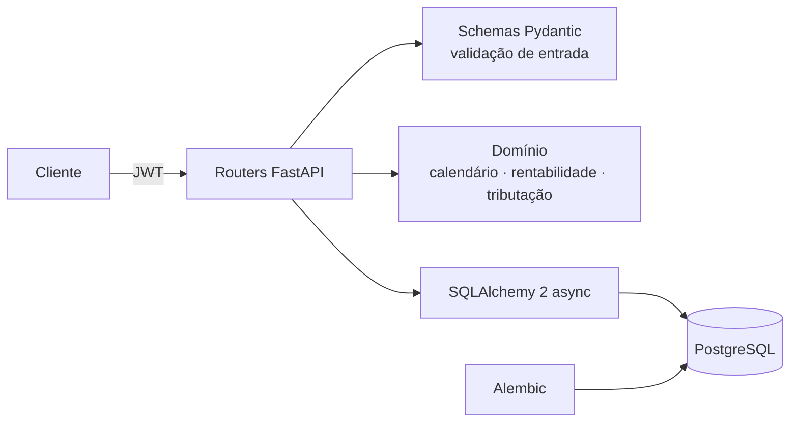

# API de Carteira de Renda Fixa


API REST para cadastrar títulos de renda fixa (CDB, LCI, LCA e Tesouro Direto) e projetar
quanto cada um vale numa data de resgate, já descontando IOF e Imposto de Renda.

O cálculo segue as convenções do mercado brasileiro: taxas em base 252 dias úteis,
calendário de feriados nacionais (padrão ANBIMA), CDI diário com 8 casas decimais,
IR regressivo pela Lei 11.033/2004 e IOF regressivo nos primeiros 30 dias.

## Arquitetura



O pacote `app/domain` é Python puro, sem FastAPI nem banco. Toda a regra de negócio
fica ali e é testada isoladamente.

## Stack

FastAPI · Pydantic 2 · SQLAlchemy 2 (async) · Alembic · PostgreSQL · JWT (PyJWT) · bcrypt ·
Pytest · Ruff · mypy (strict) · Docker · GitHub Actions

## Como rodar

Com Docker (sobe API e banco e aplica as migrações):

```bash
docker compose up --build
```

A documentação interativa fica em http://localhost:8000/docs.

Sem Docker, com um PostgreSQL local:

```bash
python -m venv .venv && source .venv/bin/activate
pip install -e ".[dev]"
cp .env.example .env          # ajuste DATABASE_URL e JWT_SECRET
alembic upgrade head
uvicorn app.main:app --reload
```

## Testes e qualidade

```bash
pytest --cov=app        # 46 testes, cobertura de 99%
ruff check . && ruff format --check .
mypy app tests
```

Os testes de API usam SQLite em memória; o CI também aplica e desfaz as migrações num
PostgreSQL real e faz o build da imagem Docker.

## Endpoints

| Método | Rota | O que faz |
| --- | --- | --- |
| POST | `/auth/registro` | Cria usuário |
| POST | `/auth/token` | Login (OAuth2 password), devolve JWT |
| GET | `/auth/me` | Usuário autenticado |
| POST | `/investimentos` | Cadastra título |
| GET | `/investimentos` | Lista os títulos do usuário |
| GET / PUT / DELETE | `/investimentos/{id}` | Detalha, altera, remove |
| GET | `/investimentos/{id}/projecao` | Projeção bruta e líquida até o resgate |
| GET | `/carteira/resumo` | Posição consolidada e participação por tipo |
| GET | `/health` | Verificação de saúde |

Cada usuário só enxerga os próprios títulos; um título de outro usuário responde 404.

## Exemplo

Um CDB de R$ 10.000 a 110% do CDI, aplicado em 02/01/2025 e resgatado no vencimento
em 04/01/2027, com CDI projetado de 14,90% a.a.:

```bash
curl "localhost:8000/investimentos/1/projecao?cdi=14.9" -H "Authorization: Bearer $TOKEN"
```

```json
{
  "projecao": {
    "data_resgate": "2027-01-04",
    "dias_corridos": 732,
    "dias_uteis": 501,
    "valor_bruto": "13549.10",
    "rendimento_bruto": "3549.10",
    "iof": "0.00",
    "ir": "532.36",
    "aliquota_ir": "0.15",
    "valor_liquido": "13016.73",
    "rentabilidade_bruta": "0.354910",
    "rentabilidade_liquida": "0.301673"
  }
}
```

As premissas `cdi`, `selic` e `ipca` (% a.a.) podem ir na query string; quando omitidas,
vêm das variáveis de ambiente.

## Como a rentabilidade é calculada

| Indexador | Campo `taxa` | Fator em `du` dias úteis |
| --- | --- | --- |
| PREFIXADO | % ao ano | (1 + taxa) ^ (du/252) |
| CDI | % do CDI | (1 + CDI diário × taxa) ^ du |
| SELIC | spread % a.a. | (1 + Selic) ^ (du/252) × (1 + spread) ^ (du/252) |
| IPCA | spread % a.a. | (1 + IPCA) ^ (du/252) × (1 + spread) ^ (du/252) |

O IOF incide sobre o rendimento nos primeiros 29 dias corridos; o IR incide sobre o
rendimento já sem IOF. LCI e LCA são isentas para pessoa física.

## Decisões técnicas

- **`Decimal` em todo o cálculo e `Numeric` no banco.** `float` acumula erro de
  arredondamento em juros compostos; valores monetários saem como string no JSON para
  não perder precisão no cliente.
- **Domínio separado da API.** As funções de cálculo recebem e devolvem tipos simples,
  o que permite testar dezenas de casos sem subir servidor nem banco.
- **Calendário calculado, não tabelado.** Os feriados móveis vêm da data da Páscoa, então
  a API funciona para qualquer ano sem atualizar uma lista.
- **404 em vez de 403** para recursos de outro usuário, para não revelar que existem.

### Limitações conhecidas

- As projeções usam taxas constantes até o resgate; não há curva de juros futura.
- Não considera taxa de custódia da B3 no Tesouro Direto nem marcação a mercado.
- Feriados municipais e estaduais não entram no calendário.

### Próximos passos

- Importar CDI, Selic e IPCA reais da API SGS do Banco Central
  (projeto "coletor de taxas" do mesmo portfólio).
- Histórico de posições e gráfico de evolução da carteira.
- Paginação e filtros na listagem.

## Licença

MIT
